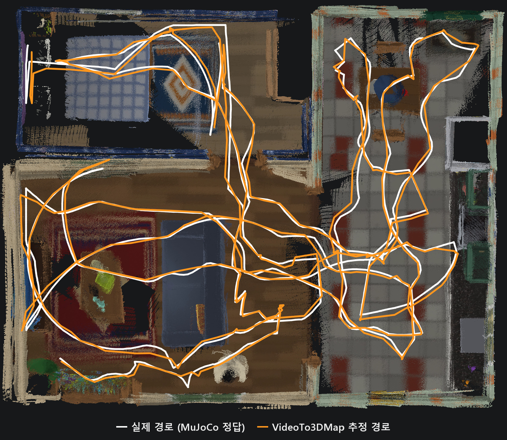
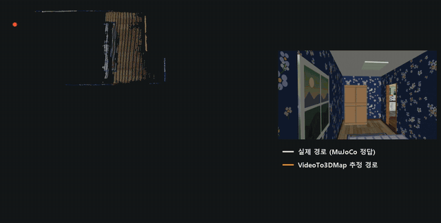

# VideoTo3DMap

영상 하나를 넣으면 3D 지도(점 구름과 keyframe 카메라 자세)가 나오는 라이브러리다. 지도의 형상은 VGGT-Omega가 만든다. keyframe을 64장씩, 이웃과 32장이 겹치게 묶은 window마다 depth와 카메라를 한 번에 추론하고, 이웃한 window는 겹친 keyframe의 모든 화소로 맞춘 Sim(3)로 잇는다.

VGGT-SLAM 2.0에서는 다시 지나간 곳을 묶는 loop closure를 가져왔다. 비슷한 keyframe 쌍을 SALAD 검색으로 고르고 VGGT-SLAM 2.0에 들어 있는 VGGT(1B)의 attention match ratio로 같은 장소인지 검증한 뒤, 받아들인 쌍을 VGGT-Omega로 다시 재구성해 두 window 사이의 제약을 만들고 모든 window의 Sim(3)를 같은 가중의 graph로 한 번에 푼다. VGGT는 이 검증 단계에만 쓰며 지도에는 들어가지 않는다.

## 결과

MuJoCo로 만든 8 × 6.5 m 집을 사람이 106초 동안 걸은 영상(2,115 프레임) 하나로 만든 지도를 천장 아래 2 m까지만 남겨 위에서 내려다본 모습이다. 흰 선은 시뮬레이터의 정답 카메라 경로, 주황 선은 VideoTo3DMap이 추정한 keyframe 경로이며, 두 경로를 Sim(3) 하나로 맞춘 오차(ATE)는 6.8 cm다. keyframe은 514장, loop closure는 10개였다.





원본 영상(2배속): [assets/house_bev_walk.mp4](assets/house_bev_walk.mp4)

## 설치와 사용

```bash
pip install git+https://github.com/MinChoi0129/VideoTo3DMap.git   # Python 3.10+, torch 2.6+, CUDA GPU
# VGGT-Omega 가중치(vggt_omega_1b_512.pt)는 huggingface.co/facebook/VGGT-Omega 에서 접근 신청 뒤 받는다. VGGT-1B, SALAD, DINOv2 는 처음 실행할 때 자동으로 받는다.
echo "reconstruction: {checkpoint: vggt_omega_1b_512.pt}" > config.yaml   # 나머지 설정은 video2map/default.yaml
python -m video2map walk.mp4 out config.yaml   # out/map.ply(점 구름), poses.txt(keyframe 카메라 자세), loops.json(loop closure)
python -c "from video2map import VideoToMap; VideoToMap('config.yaml')('walk.mp4').save('out')"   # 라이브러리로 쓸 때
```
